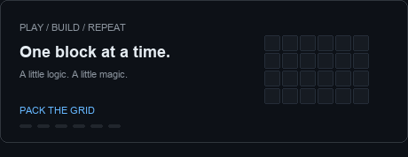
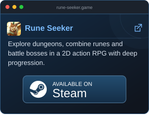

  Hi there! I'm Binh — passionate about mathematics, Unity, and 2D idle RPGs.
  <a href="http://teamobi.com/home/trang-chu.html">Teamobi's</a>
  game "Avatar" has inspired me to explore Unity!

  
  

## Tech Stack

   
  
  
  

